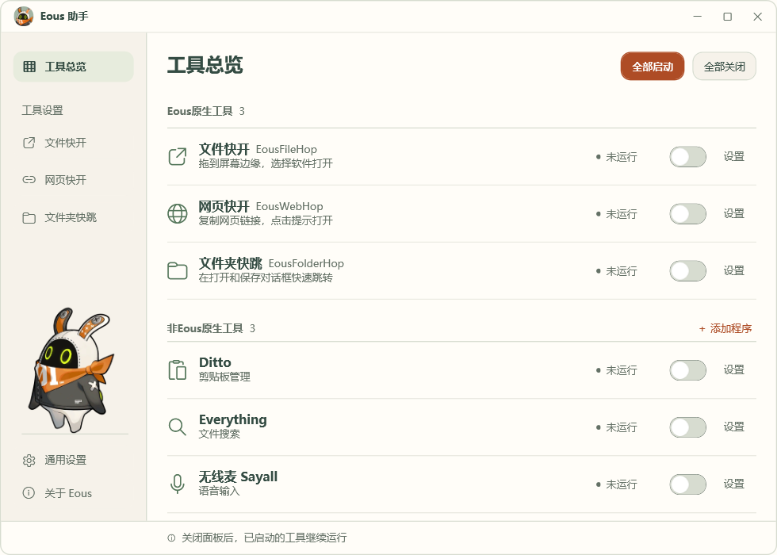
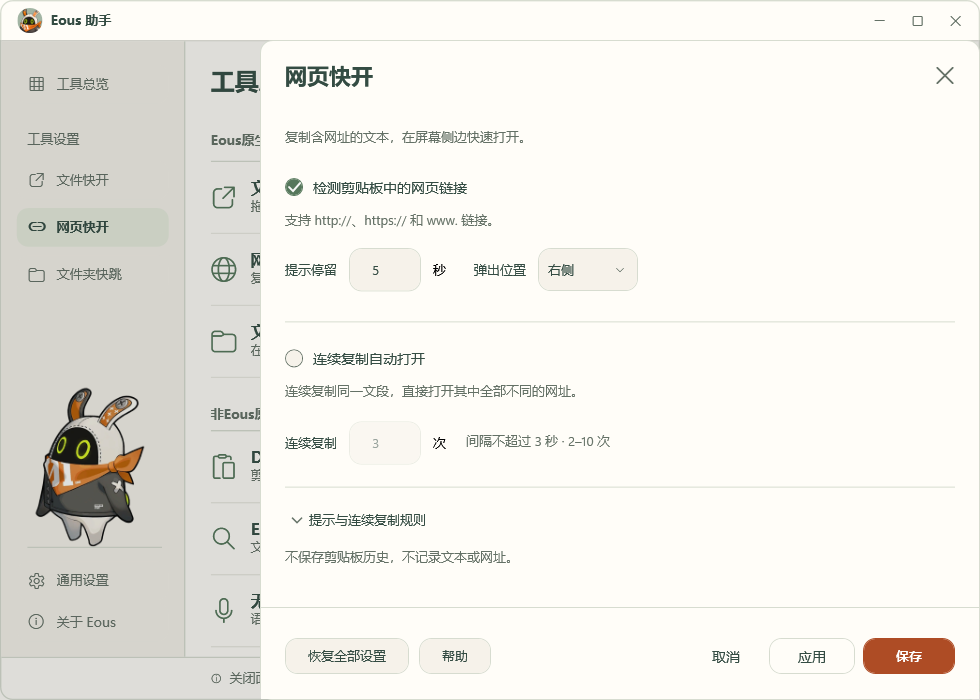

# EousAssistant · Eous 助手

Windows 11 本地桌面助手。一个程序、一个托盘，按需启动三个原生工具，并监控、启停 Ditto、Everything、无线麦 Sayall。

当前版本：`v0.2.0-beta.15.4`。代码仓库与项目文件保留 EousGate 名称，运行入口为 **EousAssistant.exe**。

采用已确认的「03 · 圆角工具清单」：暖白与鼠尾草绿、统一圆角、侧栏原画 Eous 和六行工具清单。窗口、任务栏及托盘使用 Eous 图标，角色作为侧栏伙伴融入界面。





| 工具 | 中文名 | 用途 |
|---|---|---|
| EousFileHop | 文件快开 | 把一个或多个文件拖到主屏左、右或上侧，选择软件打开 |
| EousWebHop | 网页快开 | 复制 HTTP、HTTPS、www 网页地址后，在侧边提示中点击打开 |
| EousFolderHop | 文件夹快跳 | 记录资源管理器访问目录，在打开和保存对话框中快速跳转 |

## 使用

1. 解压完整 Windows x64 绿色包，运行 `EousAssistant.exe`，无需预装 .NET Runtime。
2. 助手启动时只显示控制面板，原生模块均未运行，外部程序显示真实状态，不会自动加入开机启动。
3. 工具总览以两组清单展示六项工具；开关点击立即响应，后台确认真实状态，失败回弹并显示原因。
4. 主页右上提供 **全部启动、全部关闭**；侧栏和行尾进入各工具设置。设置以右侧抽屉打开，支持外部点击与 Esc；通用及文件/网页设置关闭时保护未保存修改，保存中防误关、失败保留输入。
5. 关闭控制面板后，已启动工具继续运行；点击托盘图标重新打开面板。在托盘菜单选择 **退出助手**，停止原生模块后退出，外部程序继续运行。
6. 再次运行程序会唤回已有面板，不会重复启动第二个助手。

遇到单项启动失败，查看该行原因；批量操作会继续处理其他工具。需要先退出旧版 EousGate 或 FolderHop，避免重复监听与快捷键争用；助手不会强行结束旧程序。

## 文件夹快跳

- 从控制面板启动 EousFolderHop 后，正常使用系统资源管理器浏览目录，窗口关闭后仍保留记录。
- 在标准 Windows 打开／保存对话框的文件列表右下角点击 **最近文件夹**，或按 **Ctrl+Alt+J**。
- 选择窗口支持最近访问、收藏、当前打开、搜索和右键移除记录。
- 模块设置可暂停记录、关闭辅助按钮、清空普通历史（保留收藏），以及打开选择窗口。
- **导入旧 FolderHop 数据**：在模块设置中选择旧目录的 `Data/history.json`。相同目录合并，保留收藏及最新访问时间，原文件不修改。
- 只有启动模块才采集目录、注册快捷键和显示按钮；停止后释放这些资源。

## 皮肤样式

助手与设置采用新确认的03方向，支持系统／浅色／深色与高对比度回退。通用设置中按需展开“辅助面板外观”，可让辅助窗口跟随助手或始终深色；原A/B配置ID继续兼容，预览不提前写入配置。

## 设置与隐私

- 配置保存于 `%LOCALAPPDATA%\EousAssistant\settings.json`，首次复制迁移旧 EousGate 配置；旧文件保留。
- 文件夹历史保存于 `%LOCALAPPDATA%\EousAssistant\FolderHop\history.json`，与助手配置分开；最多保留 200 条普通历史，收藏不受此限制。
- 不联网、不上传文件、不读取文件内容、不建立全盘索引、不修改默认文件关联。
- 网页快开只在运行时读取新复制的文本，不保存剪贴板历史。默认点击提示打开；可在“网页快开 → 设置”勾选“连续复制自动打开”，连续复制同一文段达到自定次数后，直接打开全部不同的网址。默认 3 次，可设 2–10；相邻复制间隔不超过 3 秒，同一序列只自动打开一轮。
- 文件夹快跳会在本机保存真实目录路径；可暂停记录、移除历史或清空普通历史。
- 诊断默认关闭，只记录固定事件名和时间，不记录文件名、路径、剪贴板文本或网址。
- 设置、历史损坏且无法恢复时保留原文件并提示，不静默覆盖。

## 扩展与限制

主界面按“Eous原生工具”和“非Eous原生工具”分组。Ditto、Everything、无线麦 Sayall 支持独立启停和路径设置。控制面板显示时约每两秒更新真实状态，切换到其他窗口后继续；最小化、隐藏或关闭到托盘后暂停检测，恢复面板立即刷新。暂停期间保留上次状态，已启动工具继续运行，正在进行的启停仍完成结果确认；已运行时不会重复启动。

全部启动／关闭覆盖两组工具。点击停止会先请求退出，无响应时结束身份一致的应用进程；退出助手本身会保留外部程序。Everything 的系统服务不在控制范围；Sayall 同路径的辅助进程作为同一项处理。未自动定位时，可在该行设置选择对应程序的 EXE。

首页“非Eous原生工具”右侧可 **添加程序**：选择普通 EXE，自动读取名称和图标，支持可选启动参数、编辑和移除。自定义程序默认请求正常关闭；可在高级设置允许超时强制结束。移除只取消管理，程序继续运行；不安装软件、不修改其配置或系统服务。启动器与实际运行程序不同的情况暂不单独配置监控目标。

目标环境为 Windows 11 x64。文件拖拽以主屏为边界，不接受文件夹；文件夹快跳仅适用于带地址栏的标准 Windows 文件对话框，虚拟目录、自定义选择器和管理员权限软件不保证兼容。采样约每 0.75 秒进行，快速掠过的目录可能漏记。快捷键占用时可使用面板或辅助按钮。

本轮验证包含 76 项自动化回归及文件快开分类／智能推荐与草稿保存、专用测试进程的真实启停验证、窗口样式检查、工作台即时开关、全部启停和设置遮罩、深浅色及缩放离屏渲染、文件夹模块重复启停。实际监视器 DPI、高对比度桌面、完整拖拽和 Edge 当前页面的跳转链路仍需要桌面复测，详见 [验证记录](docs/releases/v0.2.0-beta.13.md)。

## 构建

需要 Windows、.NET 8 SDK、PowerShell：

```powershell
dotnet build EousGate.csproj --configuration Release
.\Tests\run-tests.ps1 -Configuration Release
.\publish.ps1
```

发布脚本会运行 Release 测试，生成自包含目录、ZIP 和 SHA-256 校验。运行时需保留 EXE 同目录的依赖文件。开发入口见 [开发索引](docs/DEVELOPMENT-INDEX.md)。

本版未签名，请核对包来源和 SHA-256。许可证：[MIT](LICENSE)。
