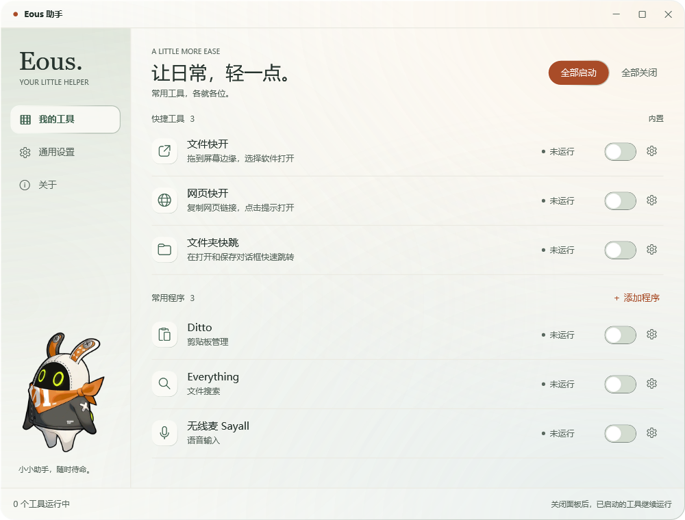
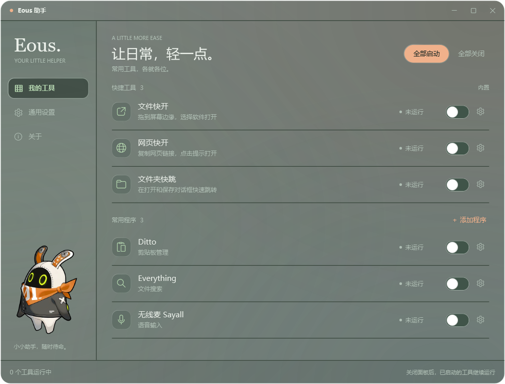
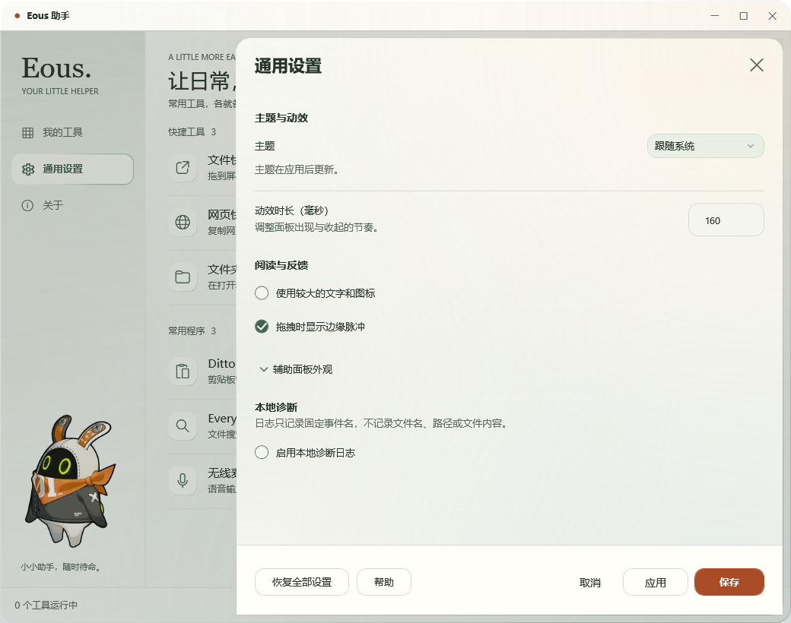

# v0.3.0-beta.1 · 轻透玻璃

日期：2026-11-09。该版本落实用户确认的透明风格交互稿；视觉和导航变化使用新的 0.3 次版本，beta.1 表示仍需桌面体验验收。工具生命周期与旧配置继续兼容，暂不标记 1.0 或正式稳定版。

## 界面

- 暖白／烟灰材质、鼠尾草绿环境色、橙色操作和细亮边，侧栏保留原画 Eous。
- 三项导航：我的工具、通用设置、关于。两组开放清单：快捷工具、常用程序；工具设置从行尾齿轮进入，提供可读工具提示和 UIA 名称。
- 保留独立开关、真实状态、失败回弹、全部启动／全部关闭、添加程序、未保存修改及保存中关闭保护。
- 主窗口请求 Windows 11 22H2 以上的系统 Acrylic 背景材质，尊重系统透明效果和高对比度；不支持或失败时回退实体底色。
- 设置抽屉、文件打开面板和链接提示保留原 layered 输入模型，使用加厚着色材质；这些窗口不具备实时桌面模糊。
- 应用主题改为读取 Windows 应用深浅偏好并响应系统偏好变化，A/B 配置 ID 保持不变。

## 验证

- 官方 .NET SDK 8.0.427（SHA-512 已核对），Release 构建零警告／零错误。
- `Tests/run-tests.ps1 -Configuration Release`：82/82 基础测试与完整集成流程通过。包含文件设置、剪贴板合成消息、原生窗口样式、权限查询、标准模态文件框、工作台与设置、外部监控、真实专用进程、启动器接力。
- 新增高对比度不透明资源及材质启用／回退策略测试；工作台浅深主题检查真实 HWND：Windows 10.0.26300.0，DWM 属性 38=3、HRESULT=0，WPF 目标透明且 DWM 深浅标志匹配。
- 保留 100/125/150/200% 各相关离屏回归；抽屉基础不透明度加厚至 250/255，避免背景文字干扰。
- 首轮启动器夹具遇到进程已出现、窗口尚未建立的时序失败；增加有界窗口就绪等待后完整重跑通过，生产关闭逻辑未改。
- 完整回归日志：`artifacts/v0.3-review/full-release-tests-final.log`；原生材质记录：`artifacts/v0.3-review/native-glass.txt`。

真实桌面检查尝试因 computer-use 返回 `Computer Use app approval timed out` 未完成，随后未发现助手窗口。DWM 属性和离屏图不代替真实桌面观感、激活／失焦、实际 DPI、高对比度桌面、跨应用拖放及 Edge 验收；旧版尚未完成的 UAC 和真实启动器退出验证继续保留。

## 绿色包

完整测试后对同一源码运行 `publish.ps1 -SkipTests`。发布目录 `artifacts/EousAssistant-win-x64`；自包含 .NET 8.0.33，无需安装 SDK 或 Runtime。文件版本 0.3.0.1，产品版本 0.3.0-beta.1（含源提交标识）。

版本包 `artifacts/EousAssistant-v0.3.0-beta.1-win-x64.zip`，稳定名称包 `artifacts/EousAssistant-win-x64.zip`，各附 SHA-256。核对 ZIP 465 项，包含 EXE、运行时、使用说明和许可证，无测试夹具、SDK 或个人配置。两份 ZIP 内容相同。

SHA-256 以发布包同名 `.sha256` 文件和 GitHub Release 附件为准；提交后重新发布会更新程序集中的源提交标识及包校验值。

运行前从托盘退出旧助手，解压完整目录后普通双击 EXE；不要只复制 EXE。回退可退出新版本并运行旧版完整目录，本轮未变更配置结构。设计决策见 [ADR 0008](../adr/0008-glass-workbench.md)。
